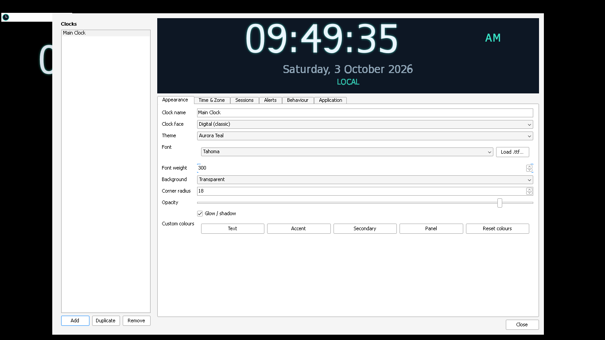
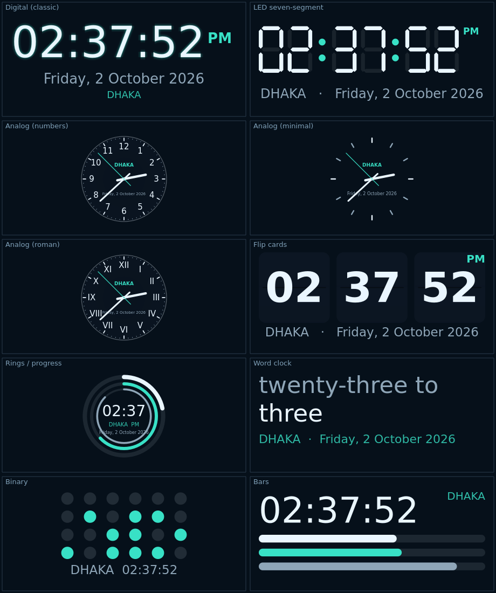
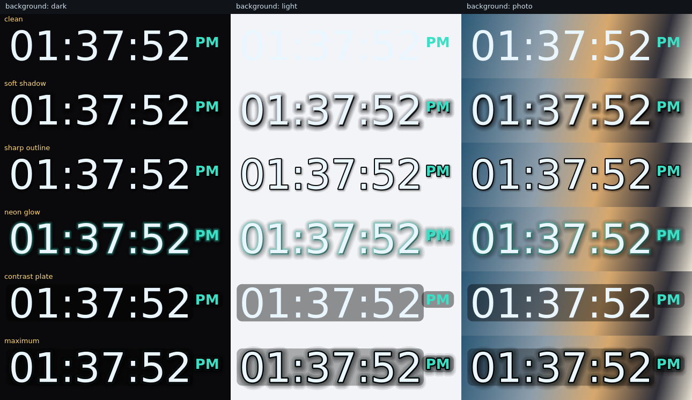
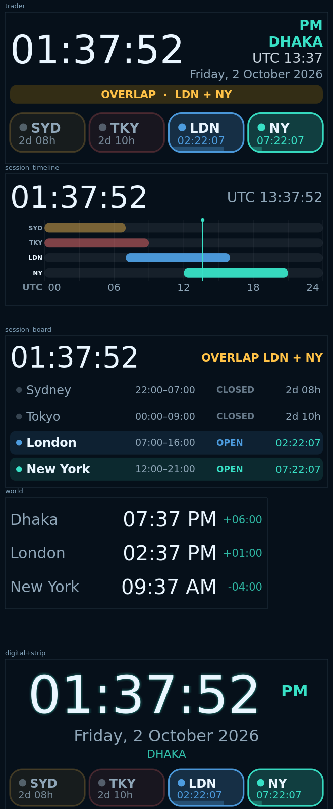

<div align="center">

# 🕐 Aurora Clock

**A beautiful, feather-light desktop clock overlay for Windows.**

Pin a clock anywhere on your desktop. It starts with Windows, remembers exactly
where you left it, stays behind your other windows, keeps itself accurate over
the internet, and never gets in your way.

[](https://github.com/emonhmamun/aurora-clock/releases/latest)
[](https://github.com/emonhmamun/aurora-clock/releases)
[](LICENSE)
[](../../actions/workflows/ci.yml)
[](#installation)

[**⬇️ Download the installer**](https://github.com/emonhmamun/aurora-clock/releases/latest) ·
[User guide](docs/USER_GUIDE.md) ·
[Build it yourself](docs/BUILDING.md) ·
[Architecture](docs/ARCHITECTURE.md) ·
[Report a bug](../../issues/new/choose)



</div>

---

## Why Aurora Clock?

Most desktop clock widgets are either a 200 MB Electron app, a browser gadget
that dies when Explorer restarts, or a floating window that covers whatever you
are actually working on. Aurora Clock is built the other way round:

| | |
|---|---|
| 🪶 **Genuinely light** | ~52 MB on disk, no background services, no browser engine. The clock repaints only when the displayed text actually changes — a digital clock costs **2 repaints per second**, not 25. |
| 🧊 **Stays out of the way** | By default it lives **on the wallpaper layer**, so Chrome, your IDE and your games always sit on top of it. Four screen layers are available if you want something else. |
| 📌 **Never moves by accident** | A **double lock** (a global *Edit mode* switch plus a per-clock *Lock*) means a stray mouse bump can never nudge your layout. |
| 🧷 **Never disappears** | Explorer restarts, `Win`+`D`, resolution changes, RDP sessions and full-screen games are all handled explicitly. |
| 🌍 **Always the right time** | Corrects itself against NTP and renders the corrected time — **without ever touching your system clock**. |
| 📈 **Built for traders** | 17 built-in market sessions (including **DSE**), live countdowns, overlap detection and kill zones. |
| 🔒 **Nothing to trust blindly** | No telemetry, no HTTP, no analytics, no admin rights, no auto-updater. ~200 automated tests enforce that on every commit. |

---

## Features

### 20 clock faces

| | | |
|---|---|---|
| Digital (classic) | LED seven-segment | Flip cards |
| Analog — numbers / minimal / roman | Rings & progress | Word clock |
| Binary | Bars | Dot matrix |
| **Stacked** (hours over minutes) | **Arc gauge** | **Neon tube** |
| **Minimal** (time only) | **Ticker strip** (one line) | World clock (multi-zone) |
| ★ Trader dashboard | ★ Session timeline (24 h) | ★ Session board |



### Colour, fonts and legibility

- **28 themes** — Aurora Teal, Midnight, Nord, Matrix, Cyberpunk, Sakura, Paper,
  Terminal Green, High Visibility and more (light-background themes included).
- **Gradient colouring** — 17 ready-made gradients (Sunset, Ocean, Fire, Liquid
  Gold, Trader Green/Red…), 5 directions, or pick your own two colours. Works on
  every face, and optionally on analog hands and bars too.
- **Any font on your PC**, plus `Load .ttf…` to import your own (it is copied
  into Aurora's folder so it keeps working after a restart).
- **Legibility engine** — drop shadow, outline, glow, contrast plate and
  automatic light/dark text, so the clock stays readable on *any* wallpaper.



### Placement and behaviour

- Unlimited clocks, each with its own face, time zone, size and position.
- 9-point snap grid, exact X/Y entry, size presets, 15–500 % scale slider,
  multi-monitor aware.
- Four screen layers: *Always on top*, *Normal*, *Background*, *On the wallpaper*.
- Click-through mode, auto-hide over full-screen apps, per-clock opacity.

### Time

- Any IANA time zone, with automatic DST.
- NTP synchronisation with a hardened client (see [SECURITY.md](SECURITY.md)).
- 12/24 hour, custom date formats, smooth or ticking seconds, blinking colon.

### Trading sessions



17 presets: Sydney, Tokyo, London, New York, Frankfurt, Hong Kong, Singapore,
Dubai, NYSE, Nasdaq, London SE, Tokyo SE, **Dhaka SE**, India NSE, and the
London / New York / Asia kill zones — with open/close countdowns, overlap
highlighting and desktop alerts on transitions.

---

## Installation

### Option 1 — Installer (recommended)

1. Download **`AuroraClock-Setup-x.y.z.exe`** from the
   [latest release](https://github.com/emonhmamun/aurora-clock/releases/latest).
2. Run it. **No administrator rights are required** — it installs into
   `%LOCALAPPDATA%\Programs\Aurora Clock`.
3. Tick *Start Aurora Clock when Windows starts* during setup (recommended).

> Windows SmartScreen may warn you because the installer is not code-signed
> (a certificate costs several hundred dollars a year). Click
> **More info → Run anyway**, or verify the SHA-256 checksum published with
> every release. You can also [build it yourself](docs/BUILDING.md).

### Option 2 — Portable

Download **`AuroraClock-x.y.z-Portable.zip`**, unzip anywhere (a USB stick
works), and run `AuroraClock.exe`. Nothing is written outside the folder except
`%APPDATA%\AuroraClock\settings.json`.

### Option 3 — From source

```bash
git clone https://github.com/emonhmamun/aurora-clock.git
cd aurora-clock
python -m venv .venv && .venv\Scripts\activate
pip install -r requirements.txt
python main.py
```

**Requirements:** Windows 10 or 11 (64-bit) for the full feature set;
Python 3.9+ and PySide6 if you run from source. The clock faces and settings
window also run on Linux/macOS for development, but the Windows-specific layers
(wallpaper Z-order, autostart, Explorer-restart recovery) are no-ops there.

---

## Quick start — place and lock your clock

1. Right-click the **tray icon** → **Edit mode ON**.
2. **Drag** the clock where you want it (or Settings → *Behaviour* → snap grid /
   exact X-Y).
3. Set the size with the presets or the **scale slider**.
4. Right-click the tray icon → **Edit mode OFF**. It can no longer be moved.
5. *(Optional, belt and braces)* Settings → tick **Lock this clock's position
   and size**.

To move it again later you must release **both** locks. The full walkthrough —
including removing duplicate clocks and choosing a screen layer — is in the
[**User Guide**](docs/USER_GUIDE.md).

---

## Command line

| Command | What it does |
|---|---|
| `AuroraClock.exe` | Start normally |
| `AuroraClock.exe --tray` | Start silently into the system tray (used by autostart) |
| `AuroraClock.exe --settings` | Start and open the settings window |
| `AuroraClock.exe --reset` | Start from factory settings (your old file is kept as `settings.json.backup`) |

---

## Privacy & security in one paragraph

Aurora Clock makes **no HTTP requests**, has **no telemetry**, **no analytics**,
**no auto-updater** and **no bundled third-party binaries** beyond Qt. The only
packet it ever sends is a 48-byte UDP NTP query to the time servers you
configure, and the reply is validated (leap indicator, mode, stratum, plausible
offset) before it is trusted. It writes to exactly two places: your settings
file and the `HKEY_CURRENT_USER` autostart key. It never writes to
`HKEY_LOCAL_MACHINE`, never asks for administrator rights, and **never changes
your system clock**. See [SECURITY.md](SECURITY.md) and
[`tests/test_security.py`](tests/test_security.py), which enforces all of this
automatically.

---

## Documentation

| Document | Contents |
|---|---|
| [User Guide](docs/USER_GUIDE.md) | Every option explained, with recipes |
| [Configuration reference](docs/CONFIGURATION.md) | Every key in `settings.json` |
| [Clock faces](docs/FACES.md) | All 20 faces, and how to write your own |
| [Building](docs/BUILDING.md) | Reproduce the `.exe` and installer |
| [Architecture](docs/ARCHITECTURE.md) | How the overlay, Z-order and render loop work |
| [Troubleshooting](docs/TROUBLESHOOTING.md) | Fixes for the common problems |
| [FAQ](docs/FAQ.md) | Short answers |
| [Changelog](CHANGELOG.md) | Every release |
| [Contributing](CONTRIBUTING.md) | How to send a patch |
| [Security policy](SECURITY.md) | Threat model and how to report an issue |

---

## Contributing

Issues and pull requests are very welcome — especially new clock faces, themes
and translations. Please read [CONTRIBUTING.md](CONTRIBUTING.md) first; it
explains the project layout, the coding style and how to run the test suite:

```bash
pip install -r requirements-dev.txt
pytest -q          # ~200 tests, runs in a few seconds
```

---

## License

Aurora Clock is free software released under the
**[GNU General Public License v3.0](LICENSE)**.

You may use, study, share and modify it freely. In return, **if you distribute
a modified version, you must publish your source code under the same licence**
so that the whole community keeps benefiting. See
[THIRD_PARTY_LICENSES.md](THIRD_PARTY_LICENSES.md) for the licences of the
components Aurora Clock builds on (Qt / PySide6 under LGPL-3.0).

```
Copyright (C) 2026 Emon Hasan Mamun

This program is free software: you can redistribute it and/or modify it under
the terms of the GNU General Public License as published by the Free Software
Foundation, either version 3 of the License, or (at your option) any later
version. This program is distributed in the hope that it will be useful, but
WITHOUT ANY WARRANTY; without even the implied warranty of MERCHANTABILITY or
FITNESS FOR A PARTICULAR PURPOSE. See the GNU General Public License for more
details.
```

<div align="center">

**Made with care for people who just want to see the time.**

⭐ If Aurora Clock is useful to you, a star helps other people find it.

</div>
